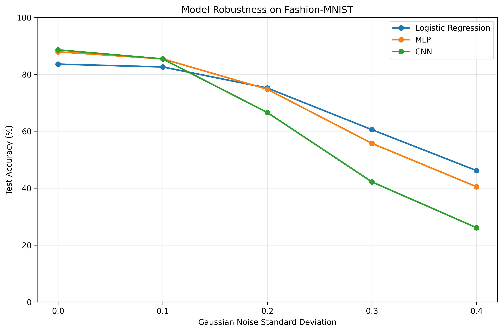
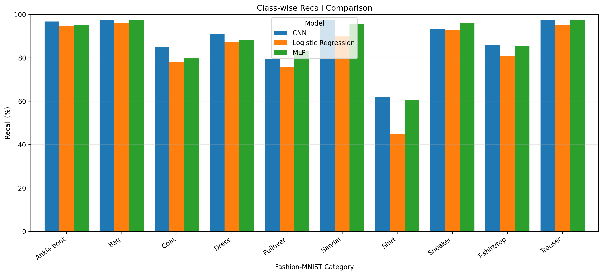
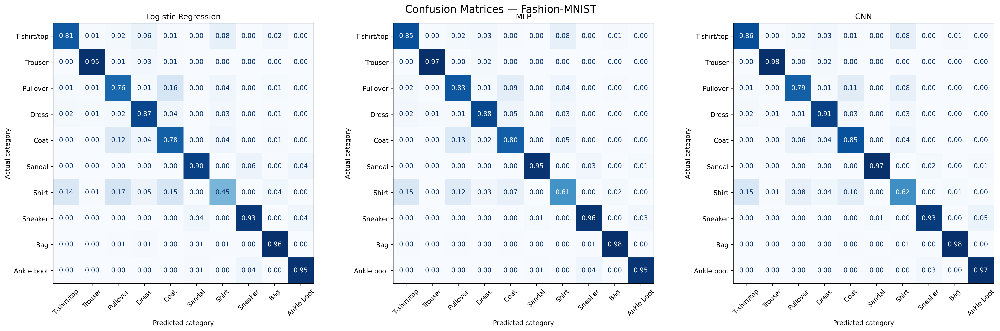

# Fashion-MNIST Research Benchmark

### Comparative Analysis of Logistic Regression, MLP and CNN

A comparative machine learning study evaluating classification accuracy, computational cost, and robustness to Gaussian noise using the Fashion-MNIST dataset.

## Research Question

How do different machine learning architectures compare in accuracy, computational cost, and robustness to noisy images?

## Overview

This project investigates three machine learning architectures:

- Logistic Regression
- Multi-Layer Perceptron (MLP)
- Convolutional Neural Network (CNN)

The models are evaluated on clean Fashion-MNIST images and under different levels of Gaussian noise.

The study also includes class-wise performance analysis, confusion matrices, and repeated experiments using multiple random seeds.

## Dataset

**Fashion-MNIST**

- 70,000 grayscale images
- Image resolution: 28 × 28 pixels
- 10 clothing categories

| Dataset split | Number of images |
|---|---:|
| Training | 54,000 |
| Validation | 6,000 |
| Testing | 10,000 |

## Models

| Model | Trainable parameters |
|---|---:|
| Logistic Regression | 7,850 |
| MLP | 235,146 |
| CNN | 105,866 |

## Experimental Setup

- Framework: PyTorch
- Optimizer: Adam
- Learning rate: 0.001
- Loss function: Cross-Entropy Loss
- Training duration: 5 epochs
- Hardware: CPU
- Random seeds for repeated experiments: 42, 123, 2026

## Results

### 1. Clean Test-Set Performance

| Metric | Logistic Regression | MLP | CNN |
|---|---:|---:|---:|
| Accuracy | 83.55% | 87.87% | **88.56%** |
| Macro Precision | 0.8340 | 0.8784 | **0.8845** |
| Macro Recall | 0.8355 | 0.8787 | **0.8856** |
| Macro F1-score | 0.8314 | 0.8775 | **0.8843** |

CNN achieved the highest clean test-set accuracy.

### 2. Gaussian Noise Robustness

Test accuracy under increasing Gaussian noise:

| Noise level | Logistic Regression | MLP | CNN |
|---|---:|---:|---:|
| 0.0 | 83.55% | 87.87% | **88.56%** |
| 0.1 | 82.56% | **85.40%** | 85.38% |
| 0.2 | **75.16%** | 74.73% | 66.55% |
| 0.3 | **60.52%** | 55.71% | 42.18% |
| 0.4 | **46.15%** | 40.48% | 26.08% |

An interesting observation is that Logistic Regression performs better under severe Gaussian noise, despite having lower accuracy on clean images.

### 3. Reproducibility Analysis

Each model was trained using three different random seeds.

| Model | Mean validation accuracy | Standard deviation | Mean training time |
|---|---:|---:|---:|
| Logistic Regression | 84.344% | 0.255 | 35.88 s |
| MLP | 87.922% | 0.212 | 47.68 s |
| CNN | **89.000%** | 0.366 | 174.19 s |

CNN achieved the highest mean validation accuracy, while MLP showed the lowest variation across the three runs.

### 4. Class-wise Analysis

The class-wise recall experiments showed:

- CNN achieved the strongest recall for several clothing categories.
- MLP performed particularly well on pullovers and sneakers.
- Shirt classification was challenging for all three architectures.
- CNN achieved 62.0% recall for shirts, compared with 60.6% for MLP and 44.8% for Logistic Regression.

## Key Findings

1. CNN achieved the highest clean test accuracy.
2. CNN achieved the highest mean validation accuracy across three random seeds.
3. Logistic Regression was more robust under severe Gaussian noise.
4. Shirt classification was challenging across all architectures.
5. Higher model complexity and clean-image accuracy do not automatically guarantee better robustness.
6. CNN required considerably more CPU training time than the other models in this experiment.

## Limitations

- Only one dataset was evaluated.
- Models were trained for five epochs.
- Reproducibility experiments used three random seeds.
- The noise experiment was limited to Gaussian pixel noise.
- Additional datasets and corruption types are needed to establish broader conclusions.
- Results do not establish statistical significance.

## Technologies Used

- Python
- PyTorch
- Torchvision
- NumPy
- Pandas
- Matplotlib
- Scikit-learn
- Google Colab

## Repository Contents

The project will include:

- Jupyter notebook containing the experiments
- Research report
- Experimental CSV files
- Accuracy and robustness plots
- Confusion matrices
- Model implementation and reproducibility instructions

## Future Work

- Evaluate additional image datasets.
- Investigate other types of image corruption.
- Increase the number of random seeds.
- Explore data augmentation and regularization.
- Investigate methods for improving robustness.

## Research Report

See [`report/research_report.md`](report/research_report.md) for the detailed experimental report.

## Author

Developed as an independent machine learning research project to investigate the relationship between classification performance, computational cost, and robustness.

**Project status:** Experimental research project — ongoing.

## Visual Results

### Model Robustness to Gaussian Noise

The CNN achieves the highest accuracy on clean images, while Logistic Regression performs better under severe Gaussian noise.

### Class-wise Recall Comparison

CNN performs well across most categories, while shirt classification remains challenging for all three models.

### Confusion Matrices

The confusion matrices illustrate classification errors across the ten Fashion-MNIST categories.

## Explore the Project

- [Open the Jupyter Notebook](notebooks/Fashion_MNIST_Research_Benchmark.ipynb)
- [Read the Research Report](report/research_report.md)
- [Browse Experimental Results](results/)
